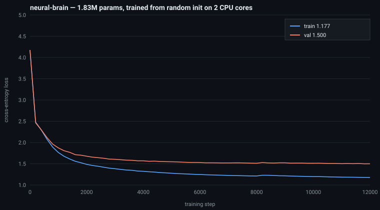

# neural-brain

A neural network that starts as random noise and teaches itself to write.

**No pretrained models. No downloaded weights. No local LLMs.** Just a
decoder-only transformer written from scratch in ~250 lines of PyTorch,
initialized with random numbers, and trained from step 0 on a 2-core CPU with
2 GB of RAM.

It learned to write Shakespeare-ish dialogue in **2 hours 45 minutes** of CPU time.

```
ROMEO:
Stay, by my heart, and by my pomfortune,
It presently enough to be a dead,
And strive mistress of the temperst of his part,
There by the body for the end of them sayze.

ROMEO:
Not with a wish the senate was commanded my brain;
And that we have well seen to thee to stir his face,
My nieble or many lips with her husband,
The matter, but the cheek marking awa
```

*(verbatim output, temperature 0.75, top-k 50 — see [`samples/final_samples.txt`](samples/final_samples.txt))*

## Results

| | |
|---|---|
| parameters | 1,830,912 (weight-tied embeddings) |
| training steps | 12,000 |
| tokens seen | ~74M (≈70 passes over the corpus) |
| loss at init | **4.181** (≈ ln 65 = 4.174, i.e. pure guessing) |
| final train loss | **1.177** |
| final held-out val loss | **1.500** (perplexity 4.54) |
| next-character accuracy (held out) | **55.5%** (random = 1.5%) |
| wall-clock | 2h 45m on 2 vCPU, ~7,500 tokens/sec |
| cost | €0 |



The model knows nothing at step 0: it emits uniform noise over 65 characters and
loses exactly ln(65). It then discovers, in order: character frequencies → spaces
→ words → line structure → `NAME:` speaker labels → blank lines between speeches
→ punctuation and verse rhythm.

What it says at each checkpoint (from [`runs/brain-01/samples.txt`](runs/brain-01/samples.txt)):

```
step   0   ,::  XI?En 33PUCY&!QddhV, ZG?qe&gAO!!!!e W.-VaASPm pu&idLtrsKl:vejw!
step 800   ROMEO: UKI as and and ouu ureand al blood: Both have I spisthd; O ive,
step 2000  ROMEO: By if the made sent of her lookie. Of the proce my lord at Romeo,
step 4000  DUKE VINCENTIO: God lords, pardon! the good still, and desperate
step 8000  ROMEO: Away and the world will the lies of the child.
step 12000 ROMEO: Stay, by my heart, and by my pomfortune, It presently enough...
```

## Architecture

| | |
|---|---|
| type | decoder-only transformer (GPT-style), next-character prediction |
| depth / width | 4 blocks / 192 dims / 6 heads |
| context | 192 characters |
| vocab | 65 characters, learned from scratch |
| attention | causal, `F.scaled_dot_product_attention` |
| positions | learned embedding |
| optimizer | AdamW, lr 6e-4, cosine decay, 300-step warmup, wd 0.1, grad clip 1.0 |
| batch | 32 × 192 = 6,144 tokens per step |

## Repo layout

```
brain/model.py    # the brain: transformer, init, generate()
brain/data.py     # character-level dataset + batch sampler
brain/train.py    # training loop: eval, LR schedule, checkpoints, samples
brain/sample.py   # load a checkpoint, let it talk
brain/export.py   # strip optimizer state -> small weights file
tests.py          # 5 sanity tests (init loss, causality, shift, resampling)
train.sh          # exact command used for the run
runs/brain-01/    # train_log.csv, samples.txt, weights.pt (7 MB)
samples/          # final generated text
plots/            # loss curve
```

## Reproduce

```bash
pip install -r requirements.txt
python tests.py                     # sanity checks
./train.sh                          # trains from scratch (~2.7h on 2 cores)
python -m brain.sample --ckpt runs/brain-01/ckpt.pt --prompt "ROMEO:" --tokens 400
```

Training is resumable (`--resume`), checkpoints every 400 steps, and logs loss /
LR / throughput to `runs/brain-01/train_log.csv`.

## Notes from the run

* The first attempt silently failed: the batch sampler built a fresh
  `torch.Generator()` on every call, so every training step saw the *identical*
  batch. The model memorized those 6,144 characters to loss 0.005 and was
  useless on anything else. `tests.py` now asserts that consecutive batches
  differ — that's the commit `454a4d1`.
* Val loss plateaued around 1.50 after ~11k steps while train kept dropping:
  1.83M parameters against 1.1M characters of text will start memorizing.
  The honest fix is more data or a smaller model, not more steps.
* Everything here is `torch` + `numpy`. No pretrained anything.
